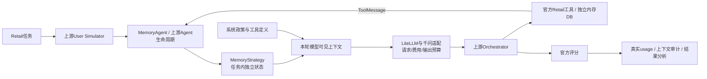

# Agent Memory Harness

**智能体记忆管理与任务执行优化（τ-bench）**：在真实工具交互中比较完整历史、预算滑窗和带来源的结构化记忆，并保留可核对的上下文、资源停止与官方评分证据。

这是一个基于 Sierra Research [tau2-bench](https://github.com/sierra-research/tau2-bench) 的个人工程与探索性实验项目。重点是**可替换的任务内记忆、受控模型调用、可解释的评测结果**，不是重新实现基准环境，也未证明普遍性能提升。

[完整实验报告](docs/final_experiment_report_zh.md) · [离线Demo命令](#环境与离线demo) · [架构说明](docs/architecture.md)

## 已完成的第一版

- 实现 `MemoryStrategy` / `MemoryState` 与可注册的 `MemoryAgent`，复用上游生成和工具执行链路。
- 同一入口选择 `full_history`、`budget_window`、`structured_memory`；每个任务/trial状态独立，完整原始轨迹与模型可见上下文分离。
- 支持输入预算检查、工具调用/返回配对、事实来源与版本审计，以及独立的总输出预算检查。
- 建立发送前持久请求计数、金额预留、零自动重试、消费授权绑定和安全停止机制；输出CSV/JSON及中文分析。
- 已取得三任务真实小样本：计划9组，7组有效评分、1组资源停止、1组未执行；102次真实请求、40次工具调用。

## 上游与个人开发边界

| 复用上游 | 本项目新增/接入 |
|---|---|
| Retail任务、数据库、政策、业务工具 | MemoryStrategy、MemoryAgent、三种任务内记忆策略 |
| LLMAgent、UserSimulator、Orchestrator、消息模型 | 最小上下文扩展点与registry注册；原普通Agent保持原有默认行为 |
| 官方动作/数据库/NL评分逻辑 | 评分有效性记录、资源停止分类、三策略编排及指标导出 |
| 模型消息转换基础与LiteLLM调用 | 千问兼容适配、离线回放、输入/输出预算与持久账本 |

固定上游来源提交：`fc0055dc4e0a316c3f83133267fbd6faaa770992`。项目使用该仓库的`tau2`包1.0.1；名称沿用τ-bench，不声称使用或复现论文全部模型配置。保留完整上游Git历史、[原始上游README](README.upstream.md)、[MIT许可证与Sierra Research版权](LICENSE)，不将上游能力写成个人原创。

## 架构与记忆插入位置



MemoryStrategy仅在下一次Agent生成前选择上下文：FullHistory返回完整可见历史；BudgetWindow移除完整旧块；StructuredMemory在必要时注入带来源的旧事实。系统政策、工具定义不由记忆策略改写；隐藏用户情境和金标只进入上游各自职责，不传给Memory。完整数据流见[架构说明](docs/architecture.md)。

## 三种策略

| 策略 | 上下文行为 | 边界 |
|---|---|---|
| `full_history` | 保留消息顺序、内容与工具ID，不摘要、不裁剪、不添加记忆提示 | 完整历史参考基线，不是优化结果 |
| `budget_window` | 以用户交互为块，保护近期完整块和工具配对，超限时从最旧可移除块删除 | 当前完整块过大时停止；不截断工具JSON |
| `structured_memory` | 维护用户原文、实体字段、操作与来源；超限时选择紧凑事实与近期块 | 确定性提取；无通用自然语言语义理解，无额外模型调用 |

有界策略使用输入预算7,168、本地安全余量128。计数器是完整请求视图上的本地`cl100k_base`估算，不是千问原生计费Token。FullHistory不暗中套用同一裁剪目标，因此这里比较的是**工程取舍**，不是相同输入预算下的能力。

StructuredMemory保留事实版本与来源，旧值标记superseded，未解决冲突保留不确定性。普通“Yes”不会自动变成所有操作的授权；自然语言无法可靠解析时保持原文。详细规则见[接口与滑窗](docs/memory_strategy.md)、[结构化记忆](docs/structured_memory.md)。

## 源码导航

```text
src/tau2/agent/
  memory.py                    # 协议、会话状态、FullHistory
  memory_agent.py              # 上游生命周期中的上下文接入
  budget_window.py             # 完整交互块与输入预算停止
  structured_memory.py         # 事实、来源、版本与紧凑注入
  input_tokens.py              # 完整输入的本地估算
validation/
  run_memory_comparison.py     # 统一入口：计划 / Mock / Demo / 导出 / 授权执行
  memory_comparison/           # 配置、编排、账本、费用与结果分析
  runtime_support/             # LiteLLM适配、输出预算、离线防护
  repository_state.py         # 固定上游来源与当前开发身份
tests/fixtures/memory/         # 冻结对照、合成及标注来源的回放摘录
docs/experiments/              # 允许公开的脱敏实验汇总
```

## 环境与离线Demo

要求Python **>=3.12,<3.14**。依赖以[pyproject.toml](pyproject.toml)为准；当前核验环境为Windows / Python3.12.14、tau2 1.0.1、LiteLLM1.82.6、OpenAI SDK3.24.0、HTTPX0.28.1、tiktoken0.14.0。无需向量库、模型训练或额外服务。依赖版本范围不保证未来解析结果完全相同，真实实验版本已记录在结果JSON。

新检出可按[上游安装说明](README.upstream.md#quick-start)准备依赖，例如`uv sync`；本次交付没有安装或升级依赖。以下命令在仓库根目录、已有`.venv`下运行，**无需Key、不联网、不重跑任务**：

```powershell
# 默认展示train69；读取Git中已有脱敏真实结果
& .\.venv\Scripts\python.exe -X utf8 -B validation/run_memory_comparison.py --demo docs/experiments/phase1_07_2_20261108/metrics.json --task 69

# 展示资源停止与未执行的区别
& .\.venv\Scripts\python.exe -X utf8 -B validation/run_memory_comparison.py --demo docs/experiments/phase1_07_2_20261108/metrics.json --task 93
```

可将`--task`设为73。macOS/Linux使用对应虚拟环境的Python路径；本轮只在上述Windows环境核验。公开Demo展示派生指标、上下文变化和工具名称；**不包含原始请求账本或未脱敏对话**。本机证据回放与导出命令见[统一评测说明](docs/memory_evaluation.md)。不需要复制作者的历史时间戳目录才能展示公开结果。

## 真实实验结果摘要

2026-11-08，Retail train69/73/93，每种策略各计划1次。运行代码`3bd27666`，结果提交`50d1b730`。实际7组有效评分：5成功、2业务失败；另1组预算停止、1组未执行。

| 策略 | 有效评分中的成功数 | 资源停止 | 未执行 | 已消耗总Token |
|---|---|---:|---:|---:|
| FullHistory | 1 / 3 | 0 | 0 | 176,038 |
| BudgetWindow | 2 / 2 | 1 | 0 | 164,928 |
| StructuredMemory | 2 / 2 | 0 | 1 | 126,008 |

分母与完成范围不同，不能直接用合计Token或这些比例排名。累计102次真实请求，输入444,145、输出22,829，共**466,974 Token**；按指定单价估算**¥0.8074365**，供应商实际账单unknown。思考Token已包含在输出中。

- train69的FullHistory在用户确认同时发出结束标记后停止，取消尚未执行。两种有界策略成功，但裁剪均发生在取消成功之后。
- train73三组均成功且未触发裁剪，没有证明显著节省。
- train93的BudgetWindow因`7,328 + 128 > 7,168`在发送前停止；现有门控阻止其后的StructuredMemory，后者不能计为失败。

[完整分析](docs/final_experiment_report_zh.md) · [原阶段报告](docs/experiments/phase1_07_2_20261108/report_zh.md) · [CSV](docs/experiments/phase1_07_2_20261108/metrics.csv) · [JSON](docs/experiments/phase1_07_2_20261108/metrics.json)

## 授权、费用与复现边界

默认入口只准备离线计划；Mock使用固定响应，不是自主模型效果实验。真实执行必须有新授权，绑定当前代码/补丁、数据指纹、comparison_id和请求上限，消费记录持久保存，旧授权不能重启清零。公开Demo不会创建或恢复授权。

实验采用Agent `qwen3.7-plus`（总输出3072、thinking_budget1536）、User `qwen3.8-flash`（总输出1024），temperature=0，内部seed42，未向供应商传seed；相同配置也可能产生不同对话。每组20请求/30步/300秒、全局180请求，HTTP阶段30秒；SDK/HTTP/任务重试0，Judge/Review0。

发送前预留请求名额与费用：输入估算加20%，输出按总上限；响应后以供应商usage结算。超时、失败、usage未知或持久化异常不返还名额并暂停；响应先保存再检查输出预算，超额/截断不继续执行工具。¥10是该次本地估算停止线，不是供应商硬封顶。已验证的网络路径与定价配置有环境依赖，不能宣称任意电脑直接复现收费结果。

凭据只由现有执行入口在授权通过后读取`AMH_QIANWEN_API_KEY`，不进入源码或日志；离线入口对子进程使用环境白名单。私有Key、历史授权、原始响应和账本均被Git排除。真实执行流程详见[统一评测说明](docs/memory_evaluation.md)，本README不附可复用的收费授权。

## 已知限制

这是一组3任务、每组合1次的探索性数据，缺1组且有资源停止，不能宣称统计显著性、稳定成功率提升或普遍成本下降。User Simulator提前结束、完整工具交互块不可继续压缩、自然语言事实只做保守记录，都是当前真实限制。

公开汇总可以离线查看、重算指标差值；从原始响应重新核算usage和重算官方评分需要保留在本地的私有证据。完整轨迹未随Git发布，公开样本不替代原始数据。未实现跨任务记忆、向量检索、语义摘要或训练，这些不属于第一版交付。
