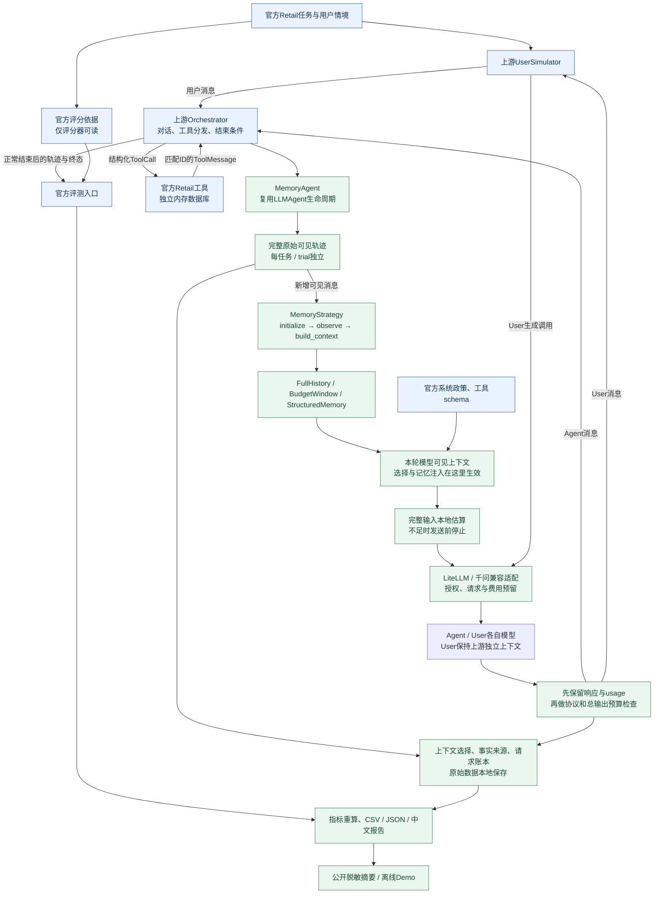

# Agent Memory Harness 架构

本图描述已实现的文本半双工Retail路径。蓝色为上游能力，绿色为本项目新增能力；模型供应商属于外部服务。Memory只处理Agent实际可见的信息。

图中User调用与Agent调用共用受控模型传输，但不共享对话状态。UserSimulator的隐藏情境只属于User，不进入Agent的Memory。金标动作不会作为Agent输入；参考轨迹只用于独立预检和官方评分。

## 实际调用链

1. `registry`选择`memory_agent`，由`create_memory_agent`构建实例。每组重新构造Agent、User与Retail环境。
2. `MemoryAgent.get_init_state`创建独立`MemoryAgentState`，内含完整`messages`、策略`memory`、游标及`context_selections`。
3. 上游`LLMAgent.generate_next_message`按原时机接收用户或工具消息，调用可覆写的`_build_model_context`。
4. `MemoryAgent._observe_pending_messages`只同步新增可见事件；策略`build_context`返回副本。系统消息由Agent加入；工具schema沿上游调用参数传递。
5. 完整输入通过`to_litellm_messages`形成计数视图。模型返回后，兼容适配器先校验消息结构、记录原始响应与usage，再交给上游Orchestrator执行工具或继续对话。
6. Assistant回复进入完整历史和Memory状态，下一轮继续。资源停止保持未评分；正常结束才记录官方评分及其有效性。

## 状态与信息边界

| 数据 | 保存位置/职责 | 是否可以被策略改写 |
|---|---|---|
| 原始可见对话 | `MemoryAgentState.messages`及本地轨迹 | 不可因裁剪而删除 |
| 策略状态 | 每会话的`MemoryState` / `StructuredMemoryState` | 可更新，但不跨任务共享 |
| 本轮上下文 | `build_context`的独立返回值 | 策略选择、压缩发生于此 |
| 官方政策、工具定义 | Agent及环境 | 不修改 |
| 隐藏用户情境、金标 | UserSimulator / 评分器 | 不传入Memory |
| 来源、版本、裁剪诊断 | `context_selections`及事实审计 | 本地保留，不任意注入模型 |

## 三个独立预算

- **输入预算**：BudgetWindow/StructuredMemory以本地完整请求视图估算，加128余量控制在7168内；FullHistory不裁剪。这不是供应商原生Token计数。
- **总输出预算**：Agent3072（含思考）、User1024；检查真实响应usage与截断状态。响应后停止只能阻断后续操作，无法撤销已经发生的费用。
- **请求与金额预算**：实际发送前持久化名额和费用预留，失败不退名额；金额按供应商usage及指定单价结算。Windows文件替换的短重试不等于API重试。

源码对应：[Memory接口](../src/tau2/agent/memory.py)、[MemoryAgent](../src/tau2/agent/memory_agent.py)、[滑窗](../src/tau2/agent/budget_window.py)、[结构化记忆](../src/tau2/agent/structured_memory.py)、[编排](../validation/memory_comparison/evaluation.py)、[费用账本](../validation/memory_comparison/fees.py)、[传输](../validation/runtime_support/budget_transport.py)。
